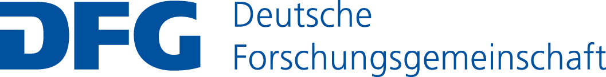

## Projektbeschreibung

DAS-Tool erleichtert die Erstellung von standardisierten Data Availability Statements im Bereich elektronischer Zeitschriften, basierend auf den DAS-Vorgaben innerhalb der unterschiedlichen Publikationskulturen und ihren Publikationsorganen. 

Im Projekt wird das DAS-Tool auf Basis von Arbeiten rund um Tools für die Erstellung von Datenmanagementplänen aufsetzen. Es wird Informationen zum Umgang mit Forschungsdaten an einer wissenschaftlichen Einrichtung und Informationen zu Forschungsdaten-Repositorien durch automatische Datenflüsse nutzen.

### Projektziele

In Bezug auf die Datenpublikationslandschaft verfolgt das Projekt folgende Ziele:

1.  Unterstützung bei der Formulierung von strukturierten, maschienenlesbaren DAS

2.  vermehrte Verknüpfung von DAS und DMPs 

3.  Zusammenspiel mit Forschungsdaten-Repositorien stärken

4.  Übersicht von Journal Policies in Bezug auf DAS 

5.  Steigerung von Akzeptanz und Implementierung von DAS bei Publikationsorganen 

6.  Förderung der digitalen Souveränität

Die exemplarische Verbindung von DAS und DMPs wird durch die Integration von RDMO und DAS-Tool realisiert.

### Projektantrag

Eine gekürzte Fassung des Projektantrags ist hier veröffentlicht:

Pampel. H., Neuroth, H. & Rothfritz, L. (2026). DAS-Tool – Data Availability Statements im Zusammenspiel mit Forschungsdaten-Repositorien und Forschungsinformation. Zenodo. <https://doi.org/10.5281/zenodo.23313849>

### Projektförderung

Das Projekt DAS-Tool ist unter der Projektnummer [578368944](https://gepris.dfg.de/gepris/projekt/528466070) durch die Deutsche Forschungsgemeinschaft gefördert.

